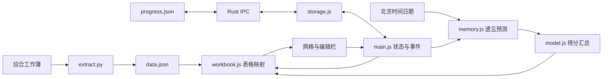

# 桌面应用架构

适用版本：1.10.0。应用是 Windows 上离线运行的 Tauri 2 程序，前端使用原生 JavaScript ES Modules 与 Vite，没有 React/Vue、服务端或数据库。Rust 负责本地文件读写，业务计算在前端纯函数中完成。

## 1. 系统边界与数据来源

| 层次 | 权威数据 | 修改与生效方式 |
| --- | --- | --- |
| 学科资料及 Excel | [综合工作簿](../../考研综合面板.xlsx)及分科文件 | 手工维护；彼此不自动同步 |
| 应用内置内容 | [src/data.json](../src/data.json) | 提取综合工作簿后重新构建应用 |
| 个人学习记录 | 正式应用数据目录中的 `progress.json` | 输入通过校验后自动保存 |
| 今日掌握度及总分 | 内置内容、个人记录、北京时间日期的计算结果 | 打开应用、切换表、提交输入或跨日时计算，不另存一套预测值 |

提取脚本只读 `.xlsx`，将题目、年度输入、布局和样式写入 JSON。运行中的 exe 不读取 Excel，不需要安装 Excel，也不会回写 Excel。`data.json` 中的 Excel 公式文本及缓存值是来源资料，应用并不运行通用 Excel 公式引擎；需要联动的数值由业务模块显式重算。

源工作簿基线：38 张表（应用另加英语表，共 39 张）；数学 3 板块、22 小节、226 节点、183 条题目记录；408 为 4 板块、24 小节、266 节点、553 条记录。新增科目或改变表结构需要修改提取和绑定逻辑，不能只替换一个任意工作簿。

## 2. 模块职责

以下路径均相对 `desktop/`。

| 模块 | 职责及主要入口 |
| --- | --- |
| [scripts/extract.py](../scripts/extract.py) | Python 标准库解析 OOXML；生成科目树、节点地址、年度数据、题目明细、布局和源文件 SHA-256 |
| [src/english.js](../src/english.js) | 动态英语表、文章新增与校验、完整精度文章数/词数统计 |
| [src/memory.js](../src/memory.js) | `today`、`daysBetween`；初学、`review`、`predictMastery`；曲线校验与旧最小值算法迁移 |
| [src/model.js](../src/model.js) | `initialState`、`validateState`、`migrateState`；`sectionMetrics`、`subjectMetrics` 全精度评分 |
| [src/workbook.js](../src/workbook.js) | `sheetLayout`、`sheetValues`、`displayValue`；坐标绑定、显示格式、408 紧凑样式覆盖 |
| [src/main.js](../src/main.js) | 表格 DOM、选中与键盘操作、输入提交、保存队列、跨日刷新、导入导出、关闭事件 |
| [src/storage.js](../src/storage.js) | 区分 Tauri IPC 与浏览器 localStorage；JSON 序列化和浏览器升级备份 |
| [src/style.css](../src/style.css) | 网格、冻结区域、选中文字覆盖、工具栏与窄窗口样式 |
| [src-tauri/src/main.rs](../src-tauri/src/main.rs) | `load_state` / `save_state`；文件路径、进程内锁、临时文件、备份与落盘 |
| [src-tauri/tauri.conf.json](../src-tauri/tauri.conf.json) | 正式标识、窗口、CSP、构建入口与应用版本 |
| [src-tauri/capabilities/default.json](../src-tauri/capabilities/default.json) | 主窗口 core 权限及关闭权限 |

## 3. 运行生命周期

1. 创建默认记录，再读取已有记录；`validateState → migrateState` 通过后才启用编辑。v1～v5 先用 load_migration_history 读取候选备份，v6～v10 直接使用 reviewOrigin；memory-migration.js 还原参数并重算最近一次 p；首次初始化或版本迁移会安排存盘，正常重开 version 12 不重置节点。
2. 按工作簿顺序呈现当前表。节点 ID 基于原掌握度单元格，例如 math:F5；展开错题行只映射显示地址，绑定 ID 仍不变。workbook.js 同时映射行高、合并和本表公式引用，跨表引用保留原地址。
3. 聚焦输入框显示原始数值并记录原文本；未修改就离开，不计为复习，也不把两位小数写回模型。
4. 提交时先刷新当日预测，保留旧状态副本。掌握度进入 `review`（同日从持久化起点覆盖，异日推进 r 和日期窗口），错题题号写 wrongQuestions 普通文本，年度分数和权重修改各自字段；整体校验失败则恢复旧状态并提示。
5. 成功后刷新单元格及总分，`persist` 复制状态快照并串行保存。修订号确保较早保存的完成消息不覆盖最新保存状态。
6. 每 30 秒、窗口重新聚焦、页面重新可见时检查日期；日期变化只重新预测，不新增复习、不存入新的曲线起点。后台暂停时可能延迟界面刷新，恢复后会补算日期差。
7. 关闭窗口先使编辑框失焦，再等待保存队列；出现保存失败时阻止关闭。读取失败状态下可关闭，但编辑停用，不自动以默认值覆盖坏文件。

## 4. 计算与显示合同

- 两科均用 JavaScript 双精度浮点数；年度加权、节点分值、遗忘参数及汇总均不主动舍入。两位小数仅用于显示。
- 小节分数为有效年份加权均值，节点分值为小节分数除以节点数；节点得分为节点分值乘内部 0～1 的预测掌握度。
- 标题中的板块占比是说明文字，不用于强行缩放实际历史加权分数。原年度数据下，两科在同一天全部节点为 100 时分别为 150.00。
- `null` 年份表示未分析，不等于已分析的零分；有效年份由科目权重字典确定。年度编辑不回写题目明细。
- 数学权重在 UI 中固定；408 权重可编辑并按合计归一化，不能全为零。
- 小节固定上下两行、节点横排；408 以数学列宽和行高为基准，但保留 A:E 冻结。数学样式保持原表口径。
- 选中节点名称以单行覆盖右侧单元格，尺寸不变；失去选中或 Esc 恢复裁切。节点名和公式不可编辑。

数学/408 的错题按钮按当前工作表切换两/三行，当前运行保留各科展开状态，重启默认收起。填充柄只在选中错题格显示，拖拽预览只取源右侧同行且绑定为 wrong-question 的目标；松开后复制原文并一次保存。题号编辑与填充不调用 review。

## 5. 变更落点与限制

| 需求 | 应检查的代码与文档 |
| --- | --- |
| 改遗忘公式、时间单位或窗口 | `memory.js`、算法说明、构建说明、数据版本迁移、算法与跨日测试 |
| 新增年份、小节或节点 | 源工作簿、`extract.py`、ID 映射、`workbook.js`、数据迁移与源指纹兼容 |
| 改数值显示或节点展开 | `workbook.js`、`main.js`、`style.css`、`DESIGN.md`、界面测试 |
| 改保存及恢复 | 前端队列、`storage.js`、Rust IPC、数据文档、原生验证 |

当前提取器固定识别数学/408、2016～2025 年度表及既定行区间；408 权重绑定 B61:B69，合计 B70。坐标 ID 与行列位置相关，移动节点可能把旧记录对应到不同知识点。必须先设计映射与迁移再重新提取，不能用“记录可以解析”代替语义兼容。

应用不提供云同步、多实例冲突合并、任意公式编辑、完整复习流水、撤销、自动复习计划或预测图表。Rust 的锁仅限单个进程；请勿同时开多个实例编辑同一份数据。后续增加这些能力属于新开发范围。

英语作为应用生成表而非试卷科目，记录模型和特殊显示口径见 [英语工作表](english.md)；原数学/408 的评分公式不参与英语统计。

1.6.0 的显示记忆率开关仅控制 main.js 的只读文本叠层：底层输入仍为原始数值，黑色掌握度与红色记忆率分别着色，焦点进入隐藏叠层，失焦和日期更新后重新适配固定列宽。不改变模型/记录 v9。旧导出、导入和重新保存的界面及事件已移除，仍由 persist 自动排队存盘。

历史1.7.0算法（已由1.8.0修正）：按复习前预测r的平方根将有效强度向初学回拉，C=28.711284228111044、B=20.164273571058075。长期未复习后新p接近0.5，仍保留90%/96%校准目标。旧r、日期、输入和文本不改，只按原reviewOrigin修正最近一次p并立即刷新预测。记录v10，升级备份progress-before-recall-v<旧版本>.json，重开不重复迁移。公式及边界以[算法说明](../../遗忘曲线算法说明.md)为准。

1.8.0：在G的额外增益中乘d(τ)=0.2+0.8×exp(−max(0,τ−5)²)，保留90%/96%目标；初学100%、每天检查且低于50%复习至100%的前六次间隔为2、3、8、14、32、100天。记录v11，独立备份progress-before-spacing-v<旧版本>.json，仅从原reviewOrigin重算最新p，历史不改。详细公式、例子和远期局限以算法说明为准。

1.9.0增加错题格局部文字Ctrl+B加粗和字体颜色，横向填充复制格式，格式随文字持久保存。记录v12新增wrongQuestionFormats；v11升级不重算曲线，独立备份progress-before-rich-text-v11.json。正式程序及桌面/开始固定入口随发布更新。

1.10.0：掌握度格按完整精度提示复习：已初学低于30红底、30至50（含50）橙底、高于50保持原背景；未初学灰底短横线，点击仍可开始初学。适用于两科节点及英语文章，跨日/复习/重开自动更新。仅显示变化，算法、已有曲线与记录v12不变。
